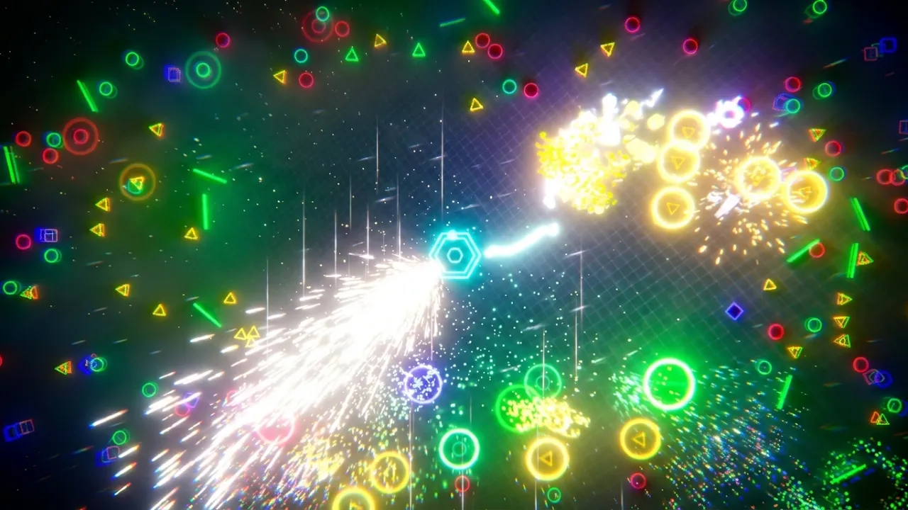

# NeonShooter

A top-down wave shooter built on the 2D physics package.
It is deliberately unpooled, so it stresses component spawn cost, batched body movement, and queries under load.
The lighting uses the experimental [2D Radiance Cascades](Packages/com.unity.2d.radiancecascades/README.md) package that ships in this project.

## Contents

- [Running it](#running-it)
- [Controls](#controls)
- [Game flow](#game-flow)
- [Menu](#menu)
- [Options](#options)
  - [Game](#game)
  - [Boss](#boss)
  - [Weapons](#weapons)
  - [Audio](#audio)
  - [Screen FX](#screen-fx)
  - [Effects](#effects)
  - [Lighting](#lighting)
  - [Visuals](#visuals)
- [Scene components](#scene-components)
- [Wave Definition asset](#wave-definition-asset)
- [License and attribution](#license-and-attribution)

## Running it

Open this folder as a project in Unity 6000.7.0b5 and open `Assets/Shooter.unity`.

## Controls

Mouse, gamepad, and touch are all live at once; use whichever suits.

| Action | Mouse and keyboard | Gamepad | Touch |
| --- | --- | --- | --- |
| Start the run | Start Game in the menu | Navigate and press South | Tap Start Game |
| Aim | Move the cursor | Left stick | Touch and hold; the gun points at your finger |
| Fire | Hold left button | Hold right trigger | The same hold both aims and fires |
| Panic bomb | Click on the ship | Right shoulder | Tap the ship |
| Pause | Escape | Start | None |
| Restart after game over | Restart in the menu | Navigate and press South | Tap Restart |
| Quit | Quit in the menu, or the QUIT box during play; in the editor this stops play mode | Quit in the menu | Tap Quit or the QUIT box |
| Clear the arena | K key (editor cheat) | None | None |

The panic bomb spins up a second gun that sweeps a full circle for a few seconds, on limited charges.
Clearing the arena is an editor-only cheat; it only works when Allow Cheat is ticked on the Wave Spawner.

## Game flow

- The scene opens on the main menu over a desaturated arena. Nothing spawns and the gun is cold until Start Game.
- Play is an endless series of cycles, each made of one set per wave in the pool.
  A set spawns several waves at once; each new cycle raises that concurrency by one until every wave runs together, then repeats.
- Firepower scales with the cycle, so the escalation stays winnable. A short warp transition plays between sets.
- Each completed cycle hands the arena to a boss: a chain of shielded enemies orbiting the player and firing at it. Beating it resumes the next cycle.
- An enemy reaching the player detonates and costs health. At zero health the run ends and the arena clears; the menu returns with the score and a Restart.

## Menu

The scene opens on the main menu: Start Game, Options, and Quit.
During a run, Escape or the gamepad's Start button pauses the game and brings the menu back with Resume, Options, Restart, and Quit.
While paused, time is stopped, the audio is silenced, and the gun is held off so a click on the menu cannot fire it.
At game over the menu returns by itself, in red, with the run's score and how far the waves got, and Restart, Options, and Quit.

The menu is driven by the pointer or by touch.
A gamepad or keyboard moves a focus highlight instead, which appears on the first stick, d-pad, or arrow press and disappears as soon as the pointer moves.

## Options

Options exposes the tunable values of the game on eight tabs.
Each row shows the live value, the value authored in the scene as "default", and a Reset that is enabled only while the two differ.
Reset Tab and Reset All restore whole groups.

Changes apply at once and save to PlayerPrefs, so they persist between runs and between player sessions.
A setting marked with an asterisk is read only when a run begins, so a change to it shows on the next run.

Each component registers its own rows in `Awake` through `GameSettings`, so adding a tunable is one line in the script that owns it.
The ranges below are the sliders' limits.

### Game

- **Invincible**: the player takes no damage. Works in a player build, unlike the editor-only Allow Cheat.
- **Max Health** \*: the health the player starts each run with (10 to 1000).
- **Damage Per Hit**: health lost for each enemy that detonates against the player (0 to 100).
- **Starting Cycle** \*: the difficulty tier to begin at; the cycle is how many waves run together and also multiplies the gun's fire rate (1 to 6).
- **Starting Set** \*: which set within the starting cycle to begin at, picking the wave that leads (1 to 6).
- **Enemy Increase**: a flat number added to every wave's enemy count (0 to 50).
- **Enemy Cycle Increase**: extra enemies added per wave for each completed cycle; the first cycle uses the authored counts (0 to 50).
- **Berserker Chance**: the probability, rolled at each regular spawn, that a berserker appears (0 to 1).
- **Max Berserkers**: how many wave berserkers may be alive at once (1 to 10).
- **Berserker Allowance**: how many berserkers a wave may spawn in total at the start of a run (0 to 20).
- **Berserker Allowance Per Set**: how much that allowance grows for every set played so far in the run (0 to 5).
  The very first wave of a run never spawns a berserker, so the opening stays gentle.
- **Spawn Margin**: distance beyond the view edge at which enemies first appear (0 to 10).
- **Spawn Depth**: extra random distance added on top of the margin, so start distances vary (0 to 10).
- **Set Delay**: the pause between sets while the warp transition plays, in seconds (0 to 10).
- **Enemy Speed**: a global multiplier on enemy movement; it scales inward speed, oscillation, and spin together so paths keep their shape (0.1 to 2).

### Boss

Every value here is read when a boss starts, so a change shows on the next boss.

- **Elements**: how many enemies make up the orbiting chain (1 to 100).
- **Orbit Radius**: the chain's distance from the player (2 to 12).
- **Orbit Speed**: how fast the chain circles the player, in degrees per second (0 to 360).
- **Spacing**: the angular gap between consecutive elements along the orbit, in degrees (1 to 45).
- **Undulation**: how far the chain's radius swings in and out as it snakes (0 to 4).
- **Shield Hits**: how many shield hits an element absorbs on the first cycle (0 to 100).
- **Shield Hits Per Cycle**: extra shield hits added to each element per later cycle (0 to 50).
- **Berserker Interval**: how often the boss rolls to fire a berserker, in seconds (0.1 to 5).
- **Berserker Chance**: the probability per roll that a berserker is fired (0 to 1).
- **Max Berserkers**: how many boss-fired berserkers may be alive at once (1 to 10).

### Weapons

- **Query Bullets**: on, bullets are query-cast and moved in a batch; off, they are dynamic physics bodies.
- **Fire Rate**: shots per second while held, before the cycle multiplier (10 to 500).
- **Bullet Speed**: launch speed in units per second (5 to 40).
- **Spread**: random per-shot deviation either side of the aim, in degrees; a held stream fans into twice this cone (0 to 45).
- **Speed Jitter**: random per-shot speed variation as a fraction of the bullet speed, staggering same-frame shots along the path (0 to 0.5).
- **Muzzle Offset**: distance from the gun pivot at which bullets appear (0 to 2).
- **Panic Duration**: how long the panic spinner runs per activation, in seconds (1 to 20).
- **Panic Spin Speed**: how fast the spinner's aim sweeps around, in degrees per second (30 to 720).
- **Panic Muzzle Radius**: the distance from center at which the spinner's bullets appear (0 to 2).
- **Panic Charges**: how many activations are available; this is the live count, so changing it mid-run changes the charges left (0 to 10).
- **Panic Trigger Radius**: how far from the ship a press still counts as triggering the bomb (0.2 to 3).
- **Panic Exposure Drop**: how far the arena's lighting is held down while the spinner runs, in stops, so hundreds of lit bullets do not wash it out (-6 to 0).

### Audio

Every row is a level in the mix (0 to 1).

- **Fire**: the gun's firing zap.
- **Hit**: a bullet striking an enemy.
- **Kill**: an enemy dying.
- **Shield**: a bullet striking an enemy shield.
- **Panic**: the panic bomb's sweep.
- **Player Hit**: the alarm when an enemy detonates against the player.
- **Drone**: the panic spinner's continuous drone.
- **Boss Drone**: the boss's background drone.
- **Berserker**: the berserker spawn alert.
- **Warp**: the set-transition whoosh.
- **UI**: the tick when the pointer moves onto a menu control.
- **Menu Ambience**: the looped ambient drone under the main menu; it fades out as the run starts.
- **Game Music**: the looped bed under the run; it fades in as the run starts and out at game over, and pauses with the pause menu.

### Screen FX

- **Vignette**: the constant vignette strength framing the arena (0 to 1).
- **Aberration Rest**: the subtle chromatic aberration always present; pulses rise above it (0 to 0.5).
- **Kill Aberration**: the aberration value an enemy kill snaps to (0 to 1).
- **Kill Blip Duration**: how quickly that kill blip falls back to rest, in seconds (0.02 to 1).
- **Aberration Peak**: the aberration at the peak of an impact pulse (0 to 1).
- **Distortion Peak**: the lens distortion at the peak of an impact pulse (0 to 1).
- **Pulse Duration**: how long an impact pulse takes to fade, in seconds (0.05 to 2).
- **Warp Pinch**: how far the warp wind-up pinches the screen inward (0 to 1).
- **Warp Aberration**: the aberration held through the warp tension (0 to 1).
- **Boss Wobble**: the swing of the slow distortion wobble held while the boss lives (0 to 0.5).
- **Boss Wobble Frequency**: the rate of that wobble, in cycles per second (0.05 to 5).
- **Boss Aberration Floor**: the raised aberration floor held during the boss (0 to 1).
- **Desaturate Duration**: how long the color drain takes at game over, in seconds (0.05 to 5).
- **Grain**: the film grain strength; 0 is off (0 to 1).
- **Grain Type**: the grain speckle coarseness, from Thin up to Large.

### Effects

- **Particle Quantity**: scales the hit sparks' and death bursts' emission (0.25 to 10).
- **Particle Lifetime**: scales how long their particles live (0.25 to 10).
- **Particle Speed**: scales their particles' start speed (0.25 to 10).
- **Particle Variation**: spreads each particle's intensity randomly below the tint; 0 keeps them all at the tint color (0 to 1).
- **Particle Glow**: pushes the particle material color past 1 so the effect blooms (1 to 8).
- **Shield Flash Duration**: how long an enemy shield's hit flash takes to fade, in seconds (0.05 to 1).
- **Shield Peak Alpha**: the flash opacity at the hit instant (0 to 1).
- **Shield Glow**: how far past 1 the flash color is pushed at the peak, driving the bloom (1 to 4).
- **Shield Punch**: how much larger than rest the ring opens before settling onto the rim (0 to 0.5).
- **Hit Flicker Duration**: how long the player sprites flicker after an enemy detonates against the ship, in seconds (0 to 2).
- **Hit Flicker Rate**: how fast that flicker alternates between the hit color and the sprites' own color (1 to 60).
- **Shake Amplitude**: the strength of the camera shake on a player hit (0 to 1).
- **Shake Duration**: how long that shake lasts, in seconds (0 to 2).

### Lighting

The arena is lit by the radiance cascades package; these rows drive the scene's lighting override.

- **Cascades**: how many levels the cascade chain runs; each level reaches four times as far, so this sets how far light carries across the screen (1 to 6).
- **Render Scale**: how many texels of the lighting's buffers one screen pixel covers; lower is cheaper and smoother, at the cost of small emitters flickering (0.25 to 1).
- **Step Stride**: how far, in texels, a ray of the finest level moves between two reads of the scene; smaller is more exact at small emitters and costs more reads (0.05 to 1).
- **Exposure**: the brightness control, in stops (-8 to 8).
- **Grid Cells**: how many background grid cells fit across the height of the view (2 to 60).
- **Grid Line Thickness**: how thick a grid line is, as a fraction of a cell; 0 leaves the surface flat (0 to 0.2).
- **Grid Cells Variation**: how far the cell count drifts either side of Grid Cells as the grid leans (0 to 30).
- **Grid Tilt Interval**: how long the grid takes to lean from one angle to the next, in seconds; 0 holds it square to the camera (0 to 30).
- **Grid Perspective**: how near the camera sits to the grid's plane; small values crowd the cells toward the vanishing point (0.3 to 6).

### Visuals

- **Shell Spin**: the ship shell's spin rate, in degrees per second (-360 to 360).
- **Ring Spin**: the dashed ring's spin rate; negative runs it opposite the shell (-360 to 360).
- **Ring Radius** \*: the ring size as a fraction of the shell radius (0.1 to 0.9).
- **Core Radius** \*: the core size as a fraction of the shell radius (0.05 to 0.5).
- **Core Boost** \*: how far past the shell color the core is pushed, driving its bloom (1 to 3).
- **Core Pulse**: the depth of the core's idle scale pulse (0 to 0.4).
- **Core Pulse Rate**: the speed of that pulse, in cycles per second (0 to 10).
- **Star Drift Speed**: the starfield's base drift speed, in units per second (0 to 10).
- **Star Firing Boost**: the drift multiplier while firing (1 to 20).
- **Star Streak**: how much drift speed stretches each star into a streak; 0 keeps them round dots (0 to 1).
- **Star Warp Boost**: the peak drift multiplier of the set-transition warp burst; it must comfortably exceed the firing boost or the burst is lost in normal drift (1 to 60).
- **Show Stats**: draws the corner overlay of cycle, enemy count, bullet count, and fps.
- **HUD Dim**: how strongly the health bar and panic pips register on screen; above roughly 0.55 they cross the bloom threshold and glow (0.1 to 1).
- **Score Glow** \*: multiplies the score text color; above 1 it pushes past the bloom threshold and glows harder (0.5 to 3).

## Scene components

What each object in `Shooter.unity` carries, and the inspector fields the menu does not reach: object references, colors, and a few values that only matter when rebuilding the scene.
Where a component exercises the physics package, a **Physics** note says how.

### GameSystems

- **Wave Spawner**. **Physics:** spawns enemy bodies and areas.
  Runs the cycle and set schedule and instantiates enemies on an off-screen ellipse.
  Inspector only: the wave pool, the Wave Movement System and Boss Wave System references, the Berserker Wave asset, and Allow Cheat (editor only; enables the K-key arena clear).
- **Wave Movement System**. **Physics:** batched [PhysicsBody.SetBatchTransform](https://docs.unity.com/en-us/engine/6000.7/script-reference/unity/u2d/physics/physicsbody/setbatchtransform).
  Moves every enemy along an analytic path in one Burst job per frame, writing all bodies and transforms in a single batched call.
- **Bullet Movement System**. **Physics:** batched [PhysicsWorld.CastGeometry](https://docs.unity.com/en-us/engine/6000.7/script-reference/unity/u2d/physics/physicsworld/castgeometry) and [PhysicsBody.SetBatchTransform](https://docs.unity.com/en-us/engine/6000.7/script-reference/unity/u2d/physics/physicsbody/setbatchtransform).
  Sweeps every query-cast bullet along its frame displacement with a circle cast, so nothing tunnels, then batches the results.
  Inspector only: Cull Margin, how far past the view edge a stray bullet travels before it is culled.
- **Player Hit System**. **Physics:** [PhysicsWorld.OverlapGeometry](https://docs.unity.com/en-us/engine/6000.7/script-reference/unity/u2d/physics/physicsworld/overlapgeometry) query.
  After each simulation step, one overlap query with the player's circle detonates every enemy touching it.
  Inspector only: the Player Area, Game Manager, and Player Hit Feedback references.
- **Boss Wave System**. **Physics:** spawns bodies and areas; orbit via [PhysicsBody.SetBatchTransform](https://docs.unity.com/en-us/engine/6000.7/script-reference/unity/u2d/physics/physicsbody/setbatchtransform).
  Runs the end-of-cycle boss: a chain of shielded enemies orbiting the player and undulating like a snake.
  Inspector only: the Wave Movement System reference, the Berserker Wave asset, and the Element Score, Berserker Score, and Kill Bonus values.
- **Game Manager**. Tracks player health and score, owns the menu, pause, and game-over states, and clears the arena on death.
  Inspector only: the Wave Spawner, Gun Controller, and Player references.
- **Sprite Render System**. Draws all bullets and enemies with instanced rendering, so their prefabs carry no SpriteRenderer.
  Inspector only: Source Material, the sprite material to draw with.
- **HUD**. Builds the score, health bar, and panic pips, plus the game-over prompt and the corner stats overlay.
  Inspector only: the Game Manager, Wave Spawner, Panic Bomb, and Player Sprite references, and Bar Below Score.
- **Panic Bomb**. The limited-charge spinning second gun.
  Inspector only: the Game Manager, Gun Controller, and Wave Spawner references, the Bullet Prefab, and Bullet Color.
- **Game Audio**. Synthesizes every effect in code at startup.
  Inspector only: the Menu Clip and Game Clip, the two shipped audio assets, each rebuilt at load with its ends crossfaded so it loops without a seam.
- **Screen FX Settings**. Drives the full-screen effects on the Global Volume: vignette, impact pulses, the warp catapult, boss unease, and the color drain.
  Inspector only: the Volume reference, found automatically when left empty.
- **Particle Settings**. Live multipliers applied to the bullet hit sparks and enemy death bursts as they spawn, on top of the prefab's authored values.
- **Shield Flash Settings**. Tuning for the enemy shield hit flash, read by every enemy.
- **GI Lighting Override** and **GI Lighting Settings**. The scene's lighting values, which replace the renderer feature's while the scene is loaded, and the component that puts them on the Lighting tab.
  Inspector only: the background's base and line colors, offset, and tilt amplitude.
- **Quit Button**. The corner quit control during play. Hidden entirely in a WebGL player.
  Inspector only: Size and Margin, in pixels.
- **Hierarchy Settings**. Hide Spawned hides spawned enemies and bullets from the Hierarchy window (on by default); untick to inspect their live physics components at the cost of per-spawn editor refresh time.

### Menu

- **UIDocument** and **Main Menu**. The UI Toolkit main and pause menu, and the controller that generates the options tabs from `GameSettings`.
  The layout and theme are `Assets/UI/Menu/MainMenu.uxml` and `MainMenu.uss`.

### Player and its Gun child

- **Physics Pose** and **Physics Area Circle**. **Physics:** body and circle shape.
  The player's physics body and its hit circle, inset within the drawn hex so hits never register past the visible rim.
  See the [Physics Pose](https://docs.unity.com/en-us/engine/6000.7/manual/unity2d/2d-physics-api/create-objects/reference-body) and
  [Physics Area Circle](https://docs.unity.com/en-us/engine/6000.7/manual/unity2d/2d-physics-api/create-objects/reference-area-circle) component references,
  and [Physics Pose and Physics Area components](https://docs.unity.com/en-us/engine/6000.7/manual/unity2d/2d-physics-api/create-objects/pose-and-area).
- **Gun Controller** (Gun child). **Physics:** spawns bullet bodies and areas.
  Aims at the input and fires unpooled bullets while the fire control is held.
  Inspector only: the two bullet prefabs (dynamic-body and query-cast), the Wave Spawner reference, and Bullet Color.
- **Player Ship Visuals**. Builds the ship look at runtime: a spinning shell, a counter-rotating dashed ring, a pulsing core, and the gun barrel.
  Inspector only: Barrel Offset, how far along the aim the barrel sits.
- **Player Hit Feedback**. Sound, camera shake, and a sprite flicker when an enemy detonates against the player.
  Inspector only: the Camera Shake reference, found on the main camera when left empty, and Hit Color.

### Background and Main Camera

- **Kill Border**. **Physics:** runtime polygon trigger areas.
  Four large off-view trigger slabs framing the camera; any bullet entering one is destroyed, catching every missed shot.
  Inspector only: the contact filter that matches bullets only, so inbound enemies cross the border freely, and the slabs' Offset and Thickness.
- **Starfield**. A parallax starfield that drifts opposite the aim, harder while firing, so shooting feels like thrust; on the menu it cruises left.
  Inspector only: the Gun Controller reference and the Star Material.
- **Camera Shake**. A subtle positional shake on the camera, requested by Player Hit Feedback. It has no inspector options; callers pass the amplitude and duration.
- **Global Volume**. The post-processing profile that Screen FX drives at runtime.

## Wave Definition asset

A ScriptableObject describing one enemy wave.
The Wave Spawner's pool and the boss chain are built from these, so editing them is the main way to shape difficulty.
Create one with Assets > Create > Shooter > Wave Definition.

- **Enemy Prefab**: the enemy this wave spawns.
- **Pattern**: how the enemies travel their inward line: Direct (straight in), Sawtooth (zig-zag), or Sine (smooth weave).
- **Speed**: inward speed toward the player, in units per second.
- **Amplitude**: the lateral oscillation half-width; ignored by Direct.
- **Frequency**: the lateral oscillation rate in cycles per second; ignored by Direct.
- **Spin Degrees Per Second**: constant spin on every enemy; zero makes them face their travel direction instead.
- **Count**: how many enemies the wave spawns in total.
- **Spawn Interval**: seconds between consecutive spawns.
- **Color**: the HDR tint identifying the wave, applied to enemy sprites and their kill particles.
- **Health**: hits an enemy of this wave survives before dying.

## License and attribution

See [LICENSE.md](LICENSE.md).
Third-party work this project builds on is listed in [ATTRIBUTION.md](ATTRIBUTION.md).
